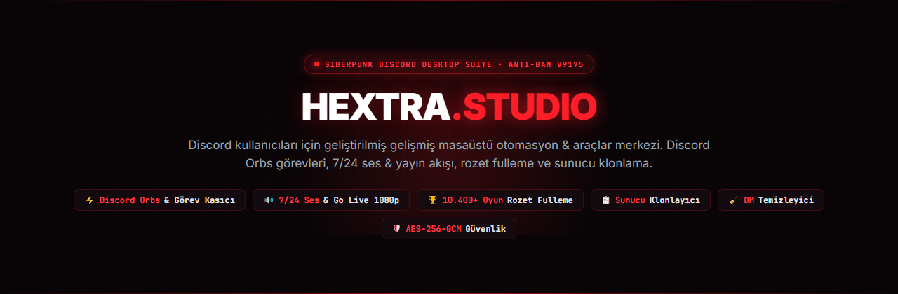
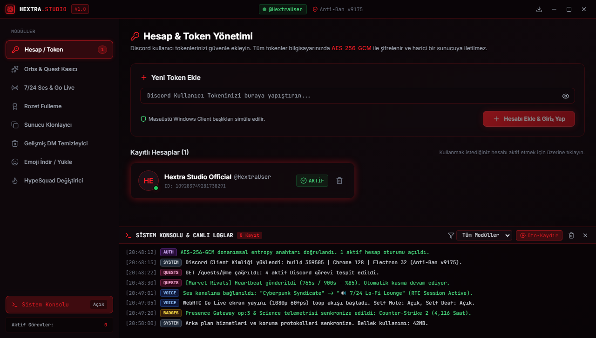
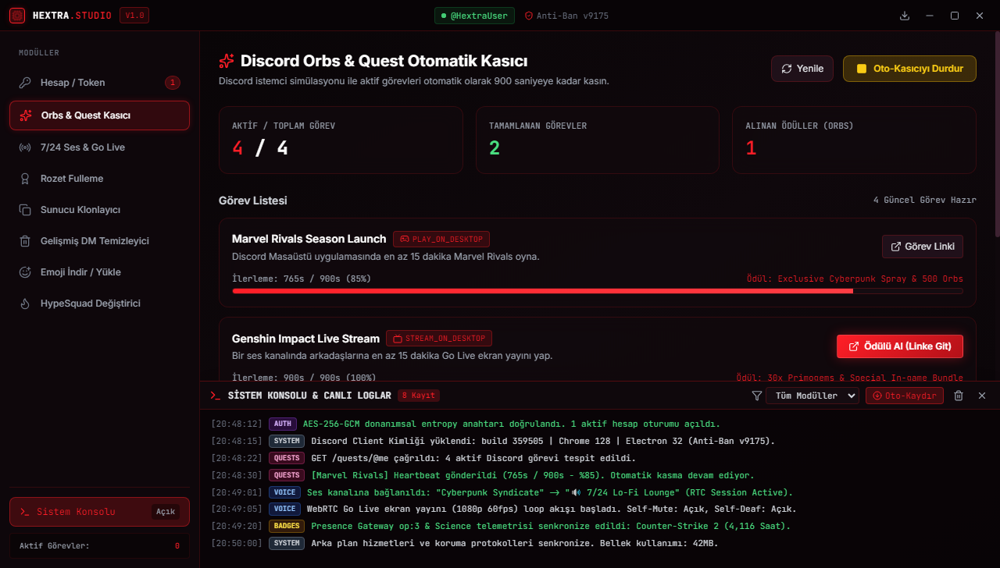
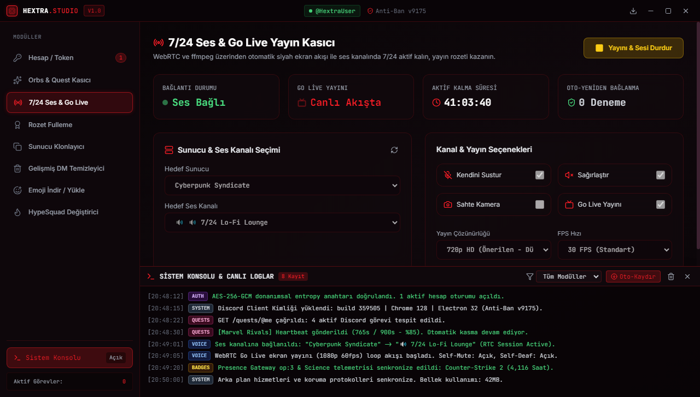
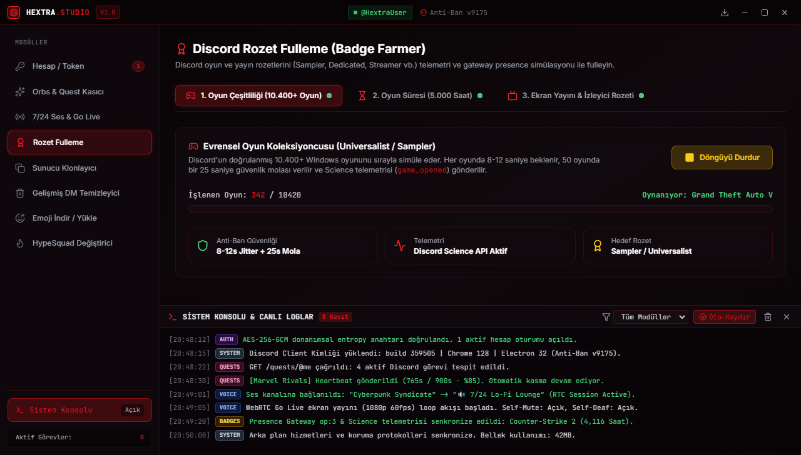
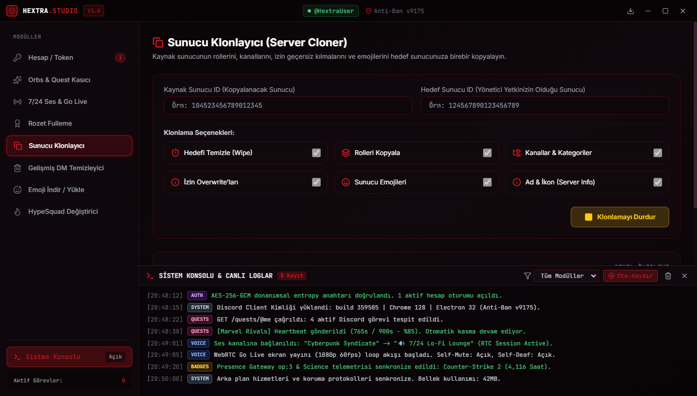
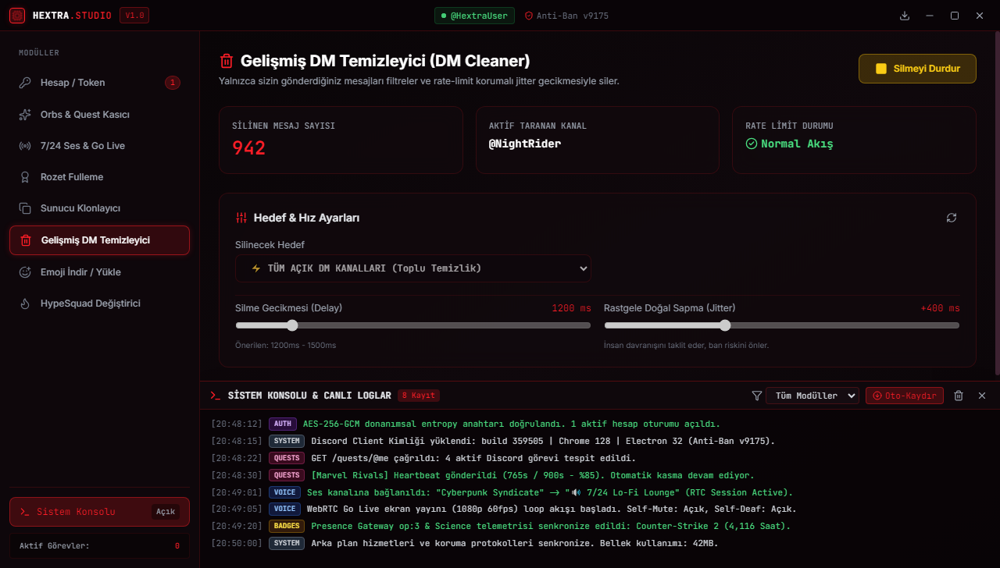
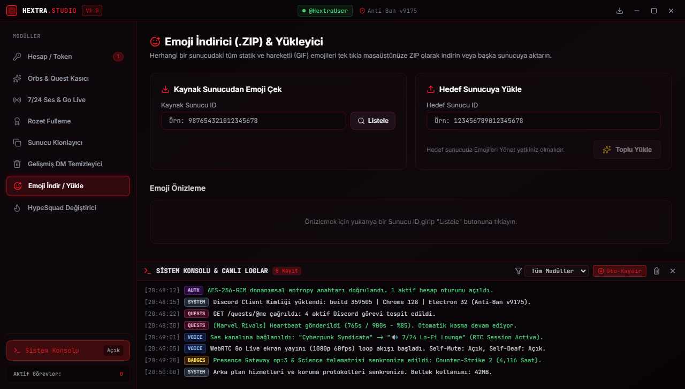
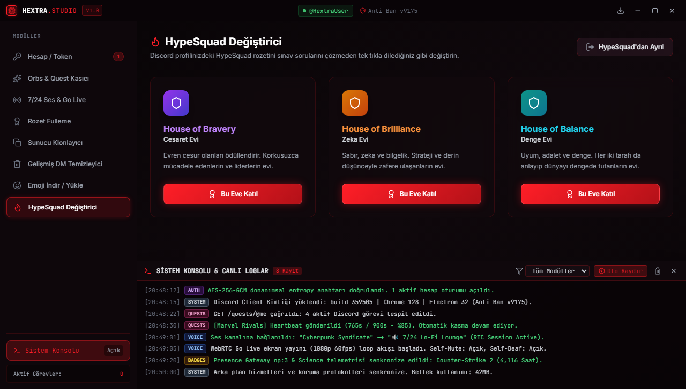
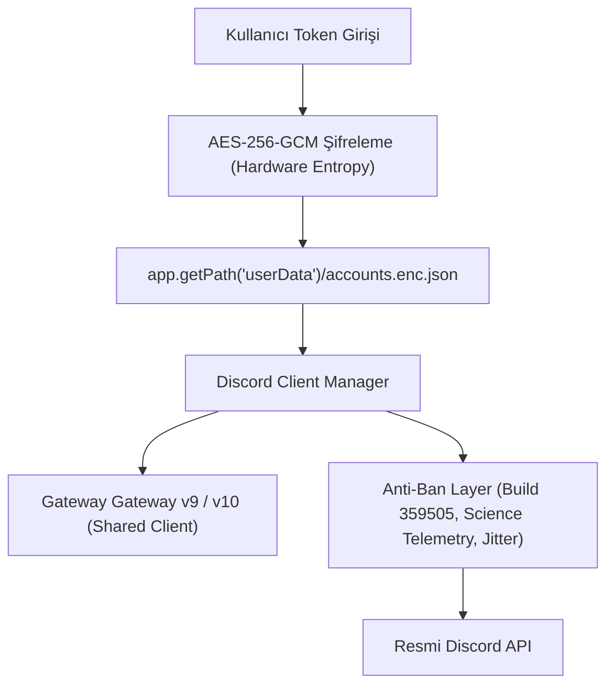

<div align="center">

  

  # ⚡ HEXTRA STUDIO
  ### Siberpunk Discord Masaüstü Otomasyon & Güç Paketi (Suite)

  [](https://www.electronjs.org/)
  [](https://react.dev/)
  [](https://www.typescriptlang.org/)
  [](https://tailwindcss.com/)
  [](LICENSE)
  [](https://github.com/)

  <p align="center">
    <strong>Hextra Studio</strong>, Discord kullanıcıları için geliştirilmiş; obsidyen siyah ve neon kırmızı siberpunk estetiğine sahip, yüksek performanslı ve tam teşekküllü bir <strong>Windows Masaüstü Uygulamasıdır</strong> (.exe).
  </p>

  <p align="center">
    <a href="#-ekran-görüntüleri--önizleme">📸 Ekran Görüntüleri</a> •
    <a href="#-temel-özellikler--modüller">🚀 Özellikler</a> •
    <a href="#-güvenlik--anti-ban-mimarisi">🛡️ Güvenlik</a> •
    <a href="#-kurulum--çalıştırma">💻 Kurulum</a> •
    <a href="#-mimari--teknik-detaylar">⚙️ Mimari</a>
  </p>

  

</div>

---

## 📌 Neden Hextra Studio?

Bu uygulama bir Discord botu **DEĞİLDİR**. Doğrudan kullanıcının bilgisayarında Electron Main Process (Node.js) üzerinde çalışan ve Discord Masaüstü İstemcisi (`Discord Client`) kimliğine bürünerek işlem yapan gelişmiş bir otomasyon merkezidir.

- 🔒 **Sıfır Dış Sunucu (Zero-Telemetry):** Hiçbir token veya veri harici sunuculara gönderilmez. Her şey yerel makinenizde kalır.
- 🔑 **AES-256-GCM Donanımsal Şifreleme:** Tokenleriniz ana makine adı, kullanıcı adı ve rastgele tuz (entropy) ile şifrelenerek depolanır.
- 🛡️ **Anti-Ban Simülasyonu:** Gerçek Discord Windows Client başlıkları (`discord/1.0.9175`, `build 359505`) ve insansı rastgele gecikmeler (jitter) ile çalışır.
- 🖥️ **Siberpunk Arayüz:** Modern cam efektli (glassmorphism) neon kırmızı karanlık tema, özel çerçevesiz pencere ve canlı sistem konsolu.

---

## 📸 Ekran Görüntüleri & Önizleme

<div align="center">

| 🔑 Hesap & Token Yönetimi | 🔮 Discord Orbs & Quest Kasıcı |
|:---:|:---:|
| [](docs/screenshots/01-accounts-management.png) | [](docs/screenshots/02-quests-farmer.png) |
| *AES-256-GCM ile çoklu hesap ve güvenli oturum yönetimi* | *Aktif Discord görevlerini (Marvel Rivals, Genshin vb.) otomatik tamamlama* |

| 🔊 7/24 Ses & Go Live 1080p | 💫 Discord Rozet Fulleme |
|:---:|:---:|
| [](docs/screenshots/03-voice-stream-24-7.png) | [](docs/screenshots/04-badge-farmer.png) |
| *WebRTC üzerinden kesintisiz siyah ekran yayını ve seste kalma* | *10.400+ oyun simülasyonu, CS2 5.000 saat ve canlı izleyici botu* |

| 📋 Sunucu Klonlayıcı | 🧹 Gelişmiş DM Temizleyici |
|:---:|:---:|
| [](docs/screenshots/05-server-cloner.png) | [](docs/screenshots/06-dm-cleaner.png) |
| *Roller, kanallar, izin geçersiz kılmaları ve emojileri kopyalama* | *Yalnızca kendi mesajlarınızı insansı gecikmeyle toplu silme* |

| 📥 Emoji İndirici & Yükleyici | ✨ HypeSquad Değiştirici |
|:---:|:---:|
| [](docs/screenshots/07-emoji-manager.png) | [](docs/screenshots/08-hypesquad.png) |
| *Sunucu emojilerini tek tıkla .ZIP olarak kaydetme ve aktarma* | *Bravery, Brilliance ve Balance rozetlerini anında değiştirme* |

</div>

---

## 🚀 Temel Özellikler & Modüller

### 1. 🔑 Hesap / Token Yönetimi (AES-256-GCM)
- **Çoklu Hesap Desteği:** İstediğiniz kadar Discord kullanıcı hesabı ekleyin, aralarında tek tıkla geçiş yapın.
- **Donanımsal Entropi:** Eklenen tokenler işletim sisteminizin `userData` dizininde donanımsal kimlik bilgileriyle türetilen **AES-256-GCM** şifresiyle saklanır.
- **Gerçek Client Başlıkları:** İstekler `Mozilla/5.0... discord/1.0.9175 Chrome/128` ve Discord'un Base64 `X-Super-Properties` paketiyle gönderilir.
- **Paylaşımlı Gateway Koruması:** Tek bir hesapta aynı anda ses, görev ve rozet kasma işlemleri tek Gateway oturumu üzerinden güvenle paylaştırılır.

### 2. 🔮 Discord Orbs & Quest Otomatik Kasıcı
- **Otomatik Görev Tespiti:** `GET /quests/@me` üzerinden kullanıcıya açık tüm aktif görevleri listeler.
- **Tek Tıkla Kayıt (Enroll):** Henüz kaydolunmamış görevlere `POST /quests/{id}/enroll` ile anında kaydolur.
- **Video Görevleri:** `POST /quests/{id}/video-progress` ile 15 dakikalık video izleme görevlerini anında tamamlar.
- **Oyun & Ekran Yayını Görevleri:** 20-25 saniyede bir doğal rastgele gecikmeyle (jitter) `POST /quests/{id}/heartbeat` göndererek görev süresini (örn. 900 saniye) doldurur.
- **Ödül Talep Etme:** Görev bittiğinde `POST /quests/{id}/claim-reward` ile ödülü (Orbs, Oyun İçi Kod, vb.) otomatik alır.

### 3. 🔊 7/24 Ses & Go Live Ekran Yayını Kasıcı
- **Ses Kanalında Kesintisiz Kalma:** `@lng2004/discord.js-selfbot-v13` ve `@dank074/discord-video-stream` motoru.
- **Akıllı Ses Seçenekleri:** `Kendini Sustur (Self-Mute)`, `Kendini Sağırlaştır (Self-Deaf)`, `Sahte Kamera (Fake Camera)` ve `Go Live Yayını`.
- **Düşük Kaynak Tüketen Akış:** Gömülü 640x360 looped `assets/black.mp4` dosyası WebRTC üzerinden Discord ses sunucusuna iletilir (CPU kullanımı <%1).
- **Üstel Geri Çekilme (Exponential Backoff):** Sunucu düşer veya internet koparsa 5s, 10s, 20s aralıklarla güvenli yeniden bağlanma döngüsü.

### 4. 💫 Discord Rozet Fulleme (Badge Farmer — 3 Mod)
1. **🎮 Evrensel Oyun Koleksiyoncusu (10.400+ Doğrulanmış Oyun):**
   - Discord'un `GET /applications/detectable` listesini önbelleğe alır.
   - Her oyunu Gateway Presence (`op: 3`), `POST /activities` ve Discord Science telemetrisi (`POST /science` — `game_opened`) ile 8-12 saniye jitter ile oynuyor gösterir. Her 50 oyunda 25 saniye anti-ban güvenlik molası verir.
2. **🗡️ Oyun Süresi (Dedicated — 5.000 Saat):**
   - CS2, Valorant, LoL, GTA V vb. popüler oyunları veya özel Application ID'yi profilde oynuyor gösterir; her 12-15 dakikada bir Discord Science telemetrisiyle süreyi senkronize eder.
3. **🏆 Ekran Yayını Rozeti (Canlı İzleyici Şartlı):**
   - Yayını başlatır; sistemde 2. bir hesap ekliyse o hesabı otomatik olarak aynı ses kanalına sokup **Canlı İzleyici (Viewer)** olarak yayına bağlar.

### 5. 📋 Sunucu Klonlayıcı (Server Cloner)
- Kaynak Sunucu ID ➔ Hedef Sunucu ID:
  1. İsteğe bağlı hedef sunucuyu temizleme (wipe channels/roles).
  2. Sunucu adını, ikonunu, doğrulama seviyesini kopyalama.
  3. Rolleri hiyerarşik sırayla kopyalama ve eski-yeni Rol ID haritası oluşturma.
  4. Kategorileri, metin/ses kanallarını sıra, konu, yavaş mod, NSFW ve **rol izin geçersiz kılmalarıyla (permissionOverwrites)** oluşturma.
  5. Sunucu emojilerini aktarma.

### 6. 🧹 Gelişmiş DM Temizleyici (DM Cleaner)
- Belirli bir kişi veya `"all"` (tüm açık DM kanalları) seçimi.
- Sadece kullanıcının kendi mesajlarını (`msg.author.id === myId`) siler.
- Ayarlanabilir gecikme (`1200ms` + jitter). `429 Too Many Requests` gelirse `retry_after` süresi kadar bekler.

### 7. 📥 Emoji İndirici & Yükleyici
- Sunucudaki tüm statik (`.png`) ve hareketli (`.gif`) emojileri masaüstüne `sunucu_adi_emojiler.zip` olarak paketler (`archiver` & `adm-zip`).
- Emojileri başka bir hedef sunucuya toplu yükleme olanağı.

### 8. ✨ HypeSquad Değiştirici
- Bravery (1), Brilliance (2), Balance (3) tek tıkla seçim veya HypeSquad'dan ayrılma.

---

## 🛡️ Güvenlik & Anti-Ban Mimarisi



| Güvenlik Kriteri | Uygulanan Önlem |
|---|---|
| **Token Güvenliği** | Tokenler kaynak kodda, git geçmişinde veya harici sunucularda ASLA tutulmaz. Yerel `accounts.enc.json` dosyasında donanımsal anahtarla şifrelenir. |
| **API Başlıkları** | Discord resmi Windows istemcisinin User-Agent ve X-Super-Properties parametreleri birebir simüle edilir. |
| **Rate-Limit Koruması** | `HTTP 429` yanıtlarında Discord'un ilettiği `retry_after` süresine milisaniyesine kadar riayet edilir. |
| **İnsansı Jitter** | Tüm döngülerde ve heartbeat isteklerinde sabit süre yerine doğal sapmalar (`+300ms`, `+750ms`) eklenir. |

---

## 💻 Kurulum & Çalıştırma

### Gereksinimler
- **İşletim Sistemi:** Windows 10 veya Windows 11 (x64)
- **Node.js:** v18.0.0 veya daha yenisi ([Node.js İndir](https://nodejs.org/))
- **Paket Yöneticisi:** `npm` (Node ile birlikte gelir)

### 1. Depoyu İndirin & Kurun
```bash
# Depoyu klonlayın
git clone https://github.com/kullaniciadi/hextra-studio.git
cd hextra-studio

# Bağımlılıkları yükleyin
npm install
```

### 2. Geliştirici Modunda Çalıştırma
```bash
npm run dev
```
*Bu komut önce TypeScript ana sürecini derler, ardından Vite geliştirici sunucusunu açar ve Electron penceresini başlatır.*

### 3. Üretim Derlemesi (Build)
```bash
# Renderer ve Main süreçlerini derler
npm run build
```

### 4. Windows `.exe` Kurulum Paketini Oluşturma
```bash
npm run build:exe
```
Çıktılar `release/` klasörüne oluşturulur:
- 📦 `release/Hextra Studio-Setup-1.0.0.exe` (NSIS Yükleyici)
- 🚀 `release/Hextra Studio-Portable-1.0.0.exe` (Kurulum Gerektirmeyen Taşınabilir Sürüm)

### 5. Ekran Görüntülerini Yeniden Oluşturma (İsteğe Bağlı)
```bash
npm run screenshots
```
*Tüm modül ekran görüntülerini ve GitHub banner görselini otomatik olarak `docs/screenshots/` altına yüksek çözünürlükte kaydeder.*

---

## 📂 Proje Dizin Yapısı

```
hextra-studio/
├── 📁 assets/                     # İkonlar ve Go Live için döngüsel black.mp4
│   ├── black.mp4
│   ├── icon.ico
│   └── icon.png
├── 📁 docs/                       # Dokümantasyon ve görseller
│   └── 📁 screenshots/            # HD Proje Ekran Görüntüleri & Banner
│       ├── banner.png
│       ├── dashboard-preview.png
│       ├── 01-accounts-management.png
│       ├── 02-quests-farmer.png
│       ├── 03-voice-stream-24-7.png
│       ├── 04-badge-farmer.png
│       ├── 05-server-cloner.png
│       ├── 06-dm-cleaner.png
│       ├── 07-emoji-manager.png
│       └── 08-hypesquad.png
├── 📁 scripts/                    # Derleme, varlık ve test otomasyon scriptleri
│   ├── capture-all-screenshots.js # Tüm sekmeleri otomatik fotoğraflayan script
│   ├── create-assets.js           # ffmpeg ile black.mp4 ve ikon oluşturan script
│   ├── dev.js                     # Vite + Electron dev server
│   ├── generate-banner.js         # Siberpunk GitHub banner oluşturucu
│   ├── postinstall.js             # libsodium paket yaması
│   └── run-capture.js             # Ekran yakalama yürütücüsü
├── 📁 src/
│   ├── 📁 main/                   # Electron Main Process (Node.js)
│   │   ├── 📁 ipc/                # IPC işleyicileri (register-handlers)
│   │   ├── 📁 services/           # TokenStore, Quests, Voice, Badges, Cloner...
│   │   └── index.ts               # Electron ana giriş dosyası
│   ├── 📁 preload/                # Güvenli contextBridge API köprüsü
│   │   └── index.ts
│   ├── 📁 renderer/               # React + TypeScript + Tailwind CSS Frontend
│   │   ├── 📁 components/         # TitleBar, Sidebar, LogTerminal
│   │   ├── 📁 views/              # 8 Adet Siberpunk Modül Görünümü
│   │   ├── App.tsx
│   │   ├── index.css
│   │   ├── main.tsx
│   │   └── mock-api.ts            # Bağımsız tarayıcı ve önizleme API simülatörü
│   └── 📁 types/                  # Ortak TypeScript tip tanımları
├── .env.example                   # Örnek ortam yapılandırması
├── .gitignore                     # Kapsamlı GitHub yoksayma kuralları
├── CONTRIBUTING.md                # Katkıda bulunma rehberi
├── LICENSE                        # MIT Lisansı
├── package.json                   # Paket bağımlılıkları ve scriptler
├── README.md                      # Ana proje tanıtım dosyası
├── SECURITY.md                    # Güvenlik ve gizlilik politikası
├── tailwind.config.js             # Siberpunk obsidian & neon renk paleti
├── tsconfig.json                  # Renderer TypeScript konfigürasyonu
├── tsconfig.main.json             # Main Process TypeScript konfigürasyonu
└── vite.config.ts                 # Vite derleyici yapılandırması
```

---

## ⚠️ Yasal Uyarı / Disclaimer

> [!WARNING]
> **Eğitim ve Araştırma Amaçlıdır:**
> Bu yazılım yalnızca eğitim, güvenlik araştırmaları ve kişisel kullanım amacıyla geliştirilmiştir. Discord Hizmet Şartları (Terms of Service - ToS), kullanıcı hesaplarının üçüncü taraf istemci veya botlarla otomatikleştirilmesini ("Selfbotting") kısıtlayabilir. Bu aracın kullanımından doğabilecek hesap askıya alınması veya engellemelerden tamamen **kullanıcı sorumludur**. Geliştirici hiçbir sorumluluk kabul etmez.

---

## 📄 Lisans

Bu proje [MIT Lisansı](LICENSE) kapsamında açık kaynak olarak yayımlanmıştır.

<div align="center">
  <sub>Geliştirici & Tasarım: <strong>Hextra Studio © 2026</strong></sub>
</div>
